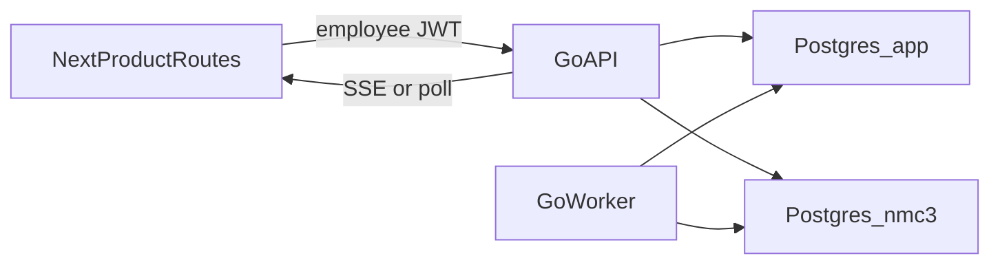

# User-supplied condensed Cursor prompt — historical

> **Not current instructions.** Dashboard work, the custom engine, fixed migration assumptions and old refs below have been superseded. See [current decisions](../decisions.md). Preserved as the text reviewed in this conversation.

Continue on cursor/dev-0d85 (12beedc), which already contains main at df5575f. Recheck refs before editing and merge newer main only if it moved. Do not reset this branch.
The product is NMC3, an internal tool for NMC2 (GPU as a service). One organization, Hardware and Software divisions, AI team inside Software. No public company signup, no partner portal, no GPU marketplace. The PR agent is a pull-request review agent.
Someone else is editing the existing dashboard. Do not change:
- frontend/src/app/(dashboard)/
- frontend/src/components/AppShell.tsx, frontend/src/theme/theme.ts, frontend/src/components/PageHeader.tsx, frontend/src/components/StatusTag.tsx, frontend/src/components/WorkflowTile.tsx, frontend/src/components/BackendStatus.tsx
- frontend/src/lib/mock-data.ts
- FRONTEND.md, docs/frontend-design.md, docs/design/
Keep frontend/src/app/layout.tsx and frontend/src/app/providers.tsx visually unchanged. NMC3 screens stay in frontend/src/app/(product)/ and frontend/src/product/. Operational dashboard screens in that product area can call Go, but they must not import or restyle the frozen dashboard.
Update agents/docs/parallel-work.md so package F no longer claims all of frontend/. Name the frozen dashboard paths and the shared files: frontend/package.json, frontend/package-lock.json, and frontend/src/lib/api.ts.
Next.js stays the client. Supabase Auth, Postgres, and private Storage stay managed services. All custom backend code moves to the root module github.com/khangdoan514/hacktx-2026.
Move agents/internal/contracts once into internal/agents/contracts, retarget agents/fixtures and the fixture test, then delete the nested module agents/go.mod. Do not keep a second copy.
```text
cmd/api
cmd/worker
internal/platform
internal/organization
internal/requests
internal/approvals
internal/capabilities
internal/context
internal/resources
internal/evaluations
internal/documents
internal/dashboards
internal/notifications
internal/audit
internal/agents/contracts
internal/agents/runtime
internal/agents/dummy
```
app holds organization and business rows. nmc3 holds runs, invocations, events, and executable definitions. One new SQL migration after supabase/migrations/20261024163000_dashboard_provenance.sql. Do not rewrite applied migrations or drop old tables until nothing reads them.
Go serves /api/v1 for business commands and the documented /v1/agent-runs, run detail, events, and /v1/agents routes. Both require the same employee auth. Add a Next.js rewrite for /v1/* to the Go server. Live updates are authorized SSE plus polling. Delete Convex (convex/) only in the cutover phase, after Go inbox/outbox works.
AGENT_EXECUTION_MODE=dummy is server configuration. Runs store that mode and adapter version. The UI uses normal names such as “PR Review Assistant” and does not show dummy badges. No live model calls, no invented token counts, and no silent fallback from a failed provider to dummy results.

Write docs/adr/go-internal-platform.md with the retain, replace, and remove list from the brief. Add failing Go tests, before the port, for the three known Python defects:
- An approval in one project must not accept a target from another scope. backend/src/app/domain/work.py currently does not bind the target to the approval’s project, and app.apply_approval_target updates by id and revision only.
- Removing workspace membership must remove project, file, and run access. Active project membership alone is not enough.
- Production startup must reject a missing JWT config and the dev-only-change-me fallback. ALLOW_LOCAL_AUTH stays impossible unless ENVIRONMENT is local or test.
cmd/api and cmd/worker with pinned go.mod / go.sum. Verify Supabase JWTs with the project issuer, audience, and JWKS. Reject the development issuer in production. Provision an employee profile from the verified subject, and grant NMC2 membership only from seed or an internal invitation, not from email domain.
Runtime DB role stays non-owner and NOBYPASSRLS, with transaction-local identity. Private Storage uploads, checksum finalization, and authorized downloads go through Go. Port the still-relevant Python tests to a separate test database.
Gate: a valid employee can read their own work; a revoked employee and a cross-scope approval cannot.
Seed one NMC2 organization, Hardware, Software, and Software/AI. Replace workspace creation and partner accounts in the product UI with team navigation. Keep tasks and handoffs as delivery records under a capability request.
Implement the request, specification, approval, and handover state machines from the brief as server commands, not a generic status patch. Forms in (product) must save drafts, submit, clarify, approve, and acknowledge. Detail pages load one record.
Gate: two employees on different teams complete one request through acknowledgement. Stale revisions and self-approval fail. No partner route remains callable.
Implement ModelAdapter.Next, the coordinator, the read-only gateway, RunStore, and EventSink from agents/internal/contracts/interfaces.go. Depth 0 may call two allowlisted specialists at depth 1. Specialists cannot delegate. HTTP handlers enqueue work; the worker leases it.
Keep the vendor orchestrator, catalog specialist, and analysis specialist as a fixture regression. Add the PR review orchestrator plus code-quality and test/security specialists over a checked-in fictional diff. Findings may cite only lines present in that input.
Gate: success, denied tool, invalid output, timeout, budget, and cancellation are persisted. Restart keeps completed history and marks abandoned work failed. The product Run screen shows the invocation tree.
Publish an immutable catalog version only after the required evaluation gate. A material spec change invalidates prior approval and evaluation evidence. Resource and budget screens record requested versus approved values and leave unmeasured usage empty.
The dashboard dummy adapter writes a schema-valid proposal. A human applies it through the same Go command as a manual edit, with source access rechecked. Do this without editing the frozen dashboard files. Product dashboard routes may be wired to Go.
Gate: publishing does not allocate hardware or grant a write tool. A stale proposal cannot be applied.
Point product fetches at Go only. Delete backend/ Python application code, convex/, and their env examples after the Go tests replace them. Leave ml/ if it is unrelated. Update README and architecture so startup is go plus Next.js, and say clearly that Auth refresh and Storage were or were not run against a real Supabase project.
Do not merge the PR or deploy. Update PR #3’s title and body to describe the Go internal platform and deterministic agents.
go test ./... and go test -race on the coordinator and worker. Browser pass with two employees: Hardware submits a PR-review request, AI asks one question, an engineer versions the spec, an authorized reviewer approves, a stale approval fails, the deterministic run is inspectable, evaluation gates publication, and the requester acknowledges handover. Removing access blocks the next read and run.
Plain Postgres is not proof of Supabase Auth or Storage. If Docker or a hosted project is still unavailable, report those checks as not run.