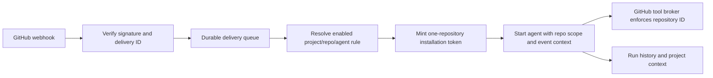

# Repository-scoped GitHub agents

## Decision

Use a **GitHub App installation** as the production connection. A project member signs in through the website, chooses repositories on GitHub's installation page, then binds one repository and branch to an application project. GitHub webhooks trigger event-based runs. Scheduled repository reports can use the existing automation worker after a repository rule is connected to it.

A workflow file is useful as an optional repo-owned trigger or context-gathering adapter, but it should not be required for the standard setup. Installation already gives GitHub's repository picker, revocation, and webhook events. Editing `.github/workflows` and distributing a repo secret for every connection would make the common path harder. GitHub confirms installation permissions can be limited to selected repositories, and installation tokens can be further restricted to one repository and expire after one hour. [Installation selection](https://docs.github.com/en/apps/using-github-apps/installing-a-github-app-from-a-third-party), [installation tokens](https://docs.github.com/en/apps/creating-github-apps/authenticating-with-a-github-app/generating-an-installation-access-token-for-a-github-app).

## What exists now

- `agents/internal/toolpacks` already has read-only GitHub tools: repository and code search, file, issues, and pull-request reads. The `workspace-assistant` definition can call them.
- The current GitHub OAuth/token connection is stored as one process-wide `github` credential in `credentials.json`. Its OAuth scope is `repo read:user`. It is **not safe for multi-user project automation**: every run would inherit the same account's private-repo access. This store must not be used for project-bound GitHub runs.
- Agent automations persist schedules and project context, but a scheduled automation does not yet select a GitHub repository rule.
- The website at `/github` can create a project, start GitHub App user OAuth, list authorized installations and branches, bind a repository/branch, create issue or pull-request rules, pause connections, and show recent runs. The API verifies candidates against GitHub again before binding and never stores a user or installation token.
- Signed webhook delivery, deduplication, installation revocation handling, rule dispatch, and the private repository tool broker are implemented and covered by local integration tests. Pull-request rules only run when the PR base branch matches the binding. File reads through the broker always use the bound branch.
- The demo App is registered, but its server credentials and installation are pending. The website currently displays that the OAuth client is not configured; live GitHub sign-in and webhook delivery have not been verified.

## User flow

1. At `/github`, choose or create a project and select **Continue with GitHub**. If the App is not installed, use the install link and select repositories on GitHub. The App requests metadata, contents, issues, and pull requests read access. Installation and repository change events, issues, and pull requests are subscribed.
2. Back on the website, select an authorized repository and one of its branches. Add an issue opened or pull-request opened/updated trigger. The current first-release agent is `github-repo-reviewer`.
3. The page shows repository/branch bindings, event rules, and recent agent runs. A project member with an agent management role can pause or enable a binding or rule. GitHub installation removal disables access.
4. The agent receives event context and a signed repository scope. Its private broker obtains a fresh one-repository installation token for tool calls and forces file reads to the selected branch.

## Data and API slice

Tables `app.github_installations`, `app.project_github_repositories` (including selected branch), `app.github_setup_sessions`, `app.github_agent_rules`, `app.github_webhook_deliveries`, and `app.github_rule_runs` are in migrations. No user or installation access token is stored. The GitHub App private key, OAuth client secret, webhook secret, and run-scope signing key belong only in server secrets. Project RLS covers bindings, setup sessions, and rules; delivery processing uses the server role.

Implemented routes include `POST /api/v1/projects/{id}/github/setup`, its OAuth callback and candidate/branch reads, `GET/POST/PATCH` repository bindings and rules, recent runs, and public `POST /api/v1/github/webhooks`. The OAuth callback gets candidate installations from GitHub with the temporary user token. The binding endpoint rechecks the installation, repository, and selected branch with an App token. GitHub setup URL query parameters are never treated as authorization. [Setup URL](https://docs.github.com/en/apps/creating-github-apps/registering-a-github-app/about-the-setup-url).

## Execution path

Validate `X-Hub-Signature-256` against the **raw** body with constant-time HMAC comparison before parsing. Deduplicate on `X-GitHub-Delivery`. Return promptly after enqueueing; a worker claims deliveries and records failures for retry. Verify repository numeric ID and installation ID against the enabled binding on every dispatch. Do not treat names, issue titles, PR bodies, or repo files as instructions. GitHub documents the signature requirement. [Webhook validation](https://docs.github.com/en/webhooks/using-webhooks/validating-webhook-deliveries).

At dispatch, sign a run scope. The private tool broker rechecks project access and the active installation before minting a token restricted to `repository_ids: [bound_repo_id]` and read-only permissions. The token never enters the model prompt or browser. The broker overrides `owner`, `repo`, and file `ref` arguments. The run record stores delivery and rule IDs and the agent run ID for audit and idempotency.

## GitHub Actions option

The [private demo repository](https://github.com/AliBenrami/nmc3-agent-integration-demo) has a workflow that handles `workflow_dispatch`, `issues.opened`, and pull-request opened/updated. It uses a read-only `GITHUB_TOKEN` to query that repository and creates a structured context summary. This proves the repo-side trigger and API access; it does **not** yet start an application agent. An Action-based production adapter would need a public, authenticated ingest endpoint (prefer GitHub Actions OIDC over a long-lived repo secret), delivery deduplication, and a separate repo-scoped credential for later agent tool calls. Avoid executing PR code in a privileged event. [Workflow token scope](https://docs.github.com/en/actions/concepts/security/github_token), [privileged PR warning](https://docs.github.com/en/actions/reference/security/securely-using-pull_request_target).

Verified on 2026-10-25: [manual run](https://github.com/AliBenrami/nmc3-agent-integration-demo/actions/runs/40173098712) succeeded and its `agent-context` artifact contained the private repository ID, default branch, and issue #1; [issue event run](https://github.com/AliBenrami/nmc3-agent-integration-demo/actions/runs/40173032325) succeeded after [issue #1](https://github.com/AliBenrami/nmc3-agent-integration-demo/issues/1) was opened. The payload contained no repository token.

Keep weekly timing in the application's existing scheduler. GitHub scheduled workflows can be delayed or dropped under load, so they should not be the source of truth for report schedules. [GitHub schedule behavior](https://docs.github.com/en/actions/how-tos/troubleshoot-workflows).

## Implementation order and acceptance

1. Register a development GitHub App with the permissions above and a reachable webhook/setup URL. Verify installation on only the private demo repo. Add repository binding and GitHub App credential minting; replace the global GitHub tool credential for bound runs.
2. Add signed webhook intake, durable deduplication, a rule for `issues.opened`, and agent dispatch. Create an issue in the private repo and verify exactly one linked agent run and repo-restricted GitHub tool calls. Replay the delivery and verify no second run.
3. Add pull-request events, run-now, project UI, and schedule binding. Verify a project user without the binding cannot read the private repo through search or explicit `owner/repo` inputs. Verify disabling the rule and revoking the installation stop new runs.
4. Add project-visible run history, last-report context, retry/error visibility, and audit logs. Confirm a weekly report can read the prior report and current repo activity.

The App is registered as `nmc3-agent-demo-20261025`, with a temporary callback/webhook tunnel that exposes only those two paths. The website is available locally on port 3012. To activate the website flow, configure one-time App server credentials in ignored environment files, mount the private key into the API container, and restart it. A user should then sign in on `/github`, choose a project, authorize GitHub, install the App on selected repositories, choose a branch, and add a trigger. Do not manually insert a binding in the database. The live proof still needs one website-based installation and a delivered event.
